# Particles on the asset-tooling kits

What render-engine's particles look like and cost on the owner's real content: asset-tooling's
effect flipbooks (`combat-effects`, `zoo-effects`) and procedural sprites, played over the
Greyhaven terrain and nature bundles and the crag kit. This is evidence, not a gate: it changes
no renderer default and no oracle scenario.

```sh
bash scripts/fetch-kits.sh                                   # pinned bundles into target/kits/
cargo run --release --example kit_showcase                   # every scene: PNG + report.json
cargo run --release --example kit_showcase -- --scaling      # particle and emitter counts
cargo run --release --example kit_showcase -- --record waterfall 45   # frames for a clip
```

`examples/kit_showcase.rs` is consumer code. It loads the bundles the way the mmorpg native
client does (`gltf`, KTX2 transcoded by `basisu`, PNG atlases with box-filtered mips), builds
emitters from render-engine's API, and turns asset-tooling's burst presets (`count`, `speed`,
`spread`, `gravity`, `lifetime`, `endScale`, `fadeOut`, `emitDuration`) into `Emitter`s. The
engine reads no files (D7). The bundles are asset-tooling rolling releases, so
`fetch-kits.sh` pins each tar by SHA-256 and fails when one is replaced.

## Scenes

| Scene | Content | Effects |
| --- | --- | --- |
| `campfire_day` | grass and gravel ground, crag faces, conifers, broadleaf, rocks, bushes; sun at 16:30, point light at the fire | fire (additive puffs), embers (velocity streaks), smoke (alpha puffs) |
| `campfire_night` | same, moonlight, ev100 2 | same |
| `combat_bursts` | same glade, close camera | `combat-effects` presets: spark, block-spark (`heavy`), impact-dust, trail |
| `zoo_bursts` | same | `zoo-effects` presets: dust, leaf, splash |
| `rain` / `snow` | glade under overcast fog | 60k streaks or flakes around the camera, ground mist |
| `waterfall` | rock ground, crag sheer faces | 3.2k/s falling sheet, `splash` bursts at the landing, spray mist |
| `magic_cloud` | glade at night | 200k-slot additive cloud (154k alive) |

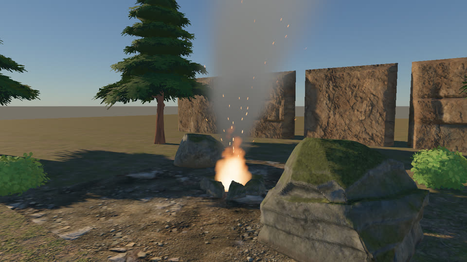
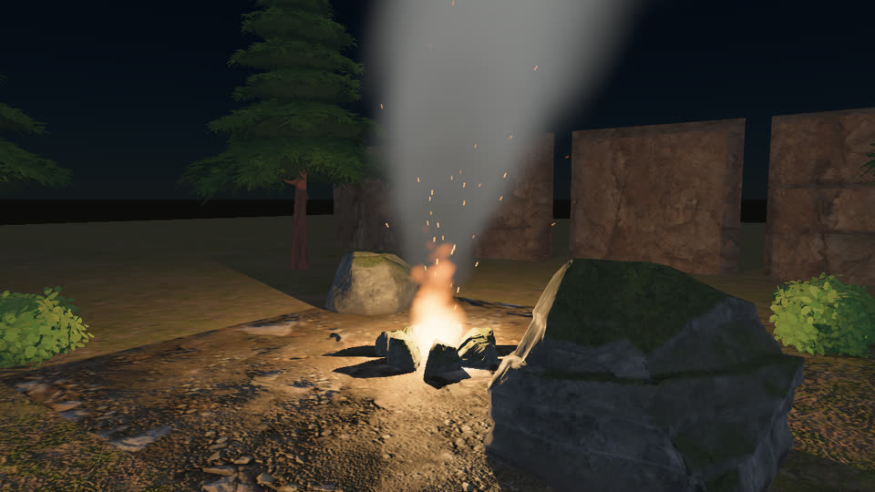
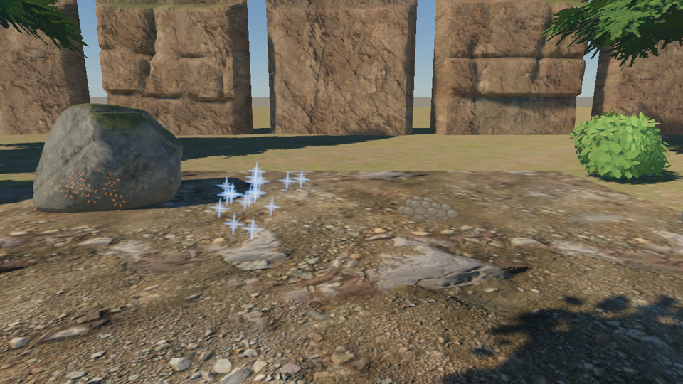
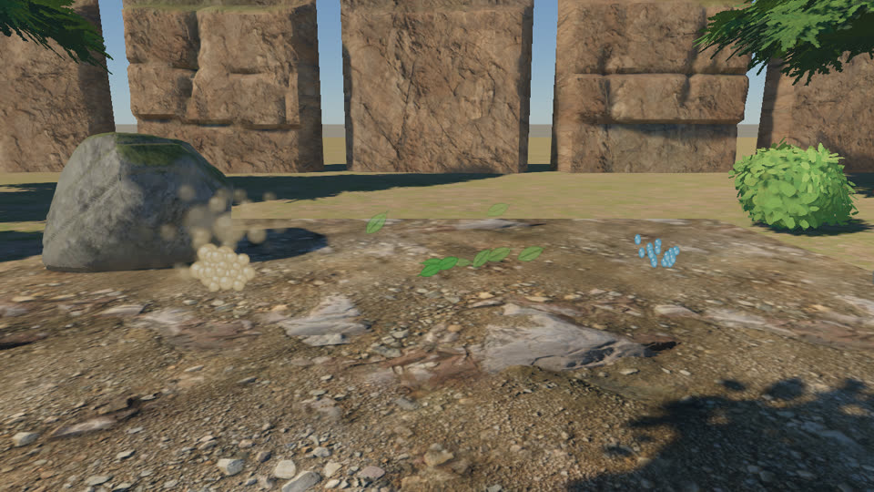
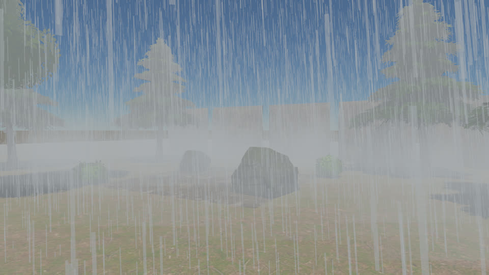
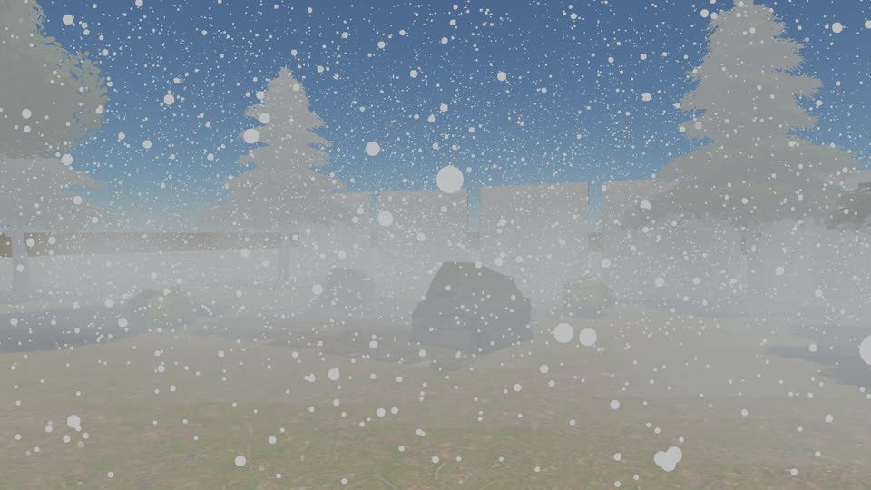

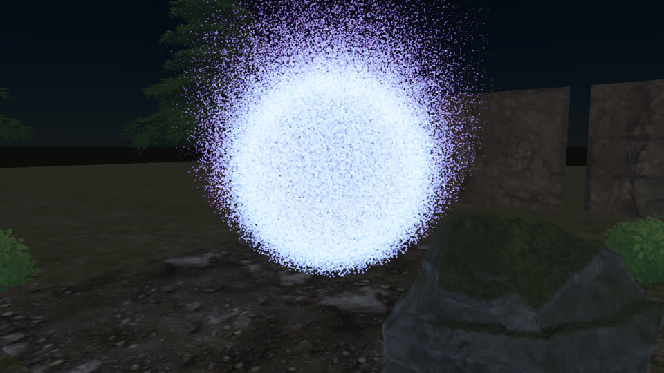

Recordings (1.5 s at 30 fps, every second 1/60 s step):

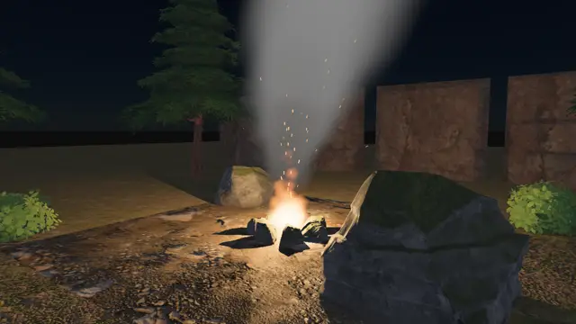
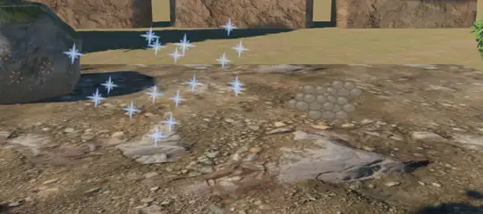
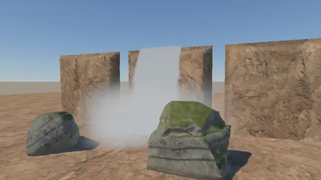

## What works

- Every kit loads and renders: Basis Universal terrain layers, alpha-masked conifer and
  broadleaf foliage, normal-mapped crag faces and rocks, with sun shadows and the sky.
- asset-tooling's 4×4 flipbooks play once over each particle's life, straight-alpha sRGB, with
  linear filtering and clamped addressing: no bleeding between cells, no dark fringes.
- The burst presets map onto the emitter API without engine changes, except the velocity cone
  (below).
- Fire, embers, smoke, rain, snow, mist and a waterfall come out of the existing modifiers
  (sphere and box positions, velocity ranges, constant acceleration, size and colour over life,
  velocity-aligned streaks, round masks).
- CPU cost does not grow with particle count. The simulation is one compute pass and each
  emitter is one indirect draw, so a frame's engine calls cost 1.0 to 1.8 ms (median) from 1k
  to 1M particles.

## What the kit scenes show is missing

These are visible in the images above. Each is a follow-up slice.

1. **Hard edges against geometry.** The fire's base, the smoke and the mist cut a straight
   line where their quads cross the ground and the rocks, as in bevy_hanabi (D9). Most visible
   in `waterfall` (spray against the rocks) and `rain` (mist on the ground). The fix is soft
   particles (depth fade).
2. **Particles are unlit and ignore exposure.** At night (`campfire_night`) the smoke keeps
   its daylight grey and glows against the sky. The dust in `zoo_bursts` stays bright inside
   the rock's shadow. The particle colour is written as-is, with no lights, shadows or exposure.
3. **No fog on particles.** In `rain` and `snow` the far streaks and flakes stay crisp through
   fog that hides the crag faces behind them.
4. **Many small emitters are expensive on the CPU** (scaling below): about 25 µs per emitter
   per frame, so 1000 burst emitters cost 25 ms. Each emitter is a draw, a 768-byte step
   upload and a texture bind group created every frame (`ParticleFrame::prepare`).
5. **No velocity cone.** asset-tooling's presets emit in a cone (`direction`, `spread`), and
   hanabi's init modifiers have none, so the showcase approximates it with a box of velocities.
   The `trail` preset's segment `instances` are not modelled either.
6. **Alpha emitters are not sorted inside.** Dense alpha effects (smoke, spray) draw in GPU
   alive-list order, as hanabi does. At the densities here no artefact is visible yet.

The owner decided (2026-11-10) that 1–3 are built as opt-in emitter options, with hanabi
parity kept as the default. Lit and fogged particles get an oracle of Bevy `StandardMaterial`
camera-facing quads; soft particles are checked by tests and these kit scenes. D9 is updated
in those PRs.

## Soft particles (#83)

`Emitter::depth_fade` is opt-in. In the kit scenes the fire (0.35 m), smoke (0.8 m), mist
(1.5 m), waterfall spray (0.6 m) and alpha bursts (0.15 m) use it; `--hard` renders the same
frames without it. Left hard, right soft, same seeds and steps:

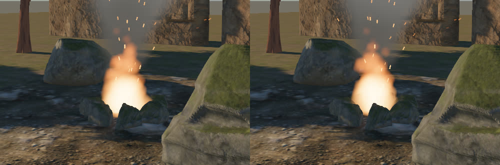
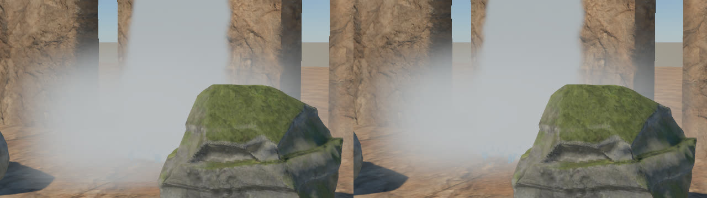
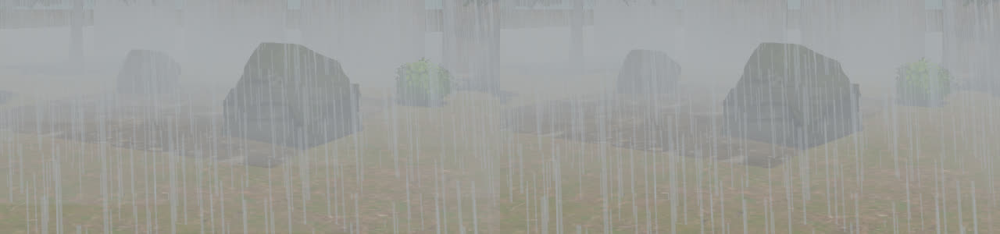

The fire's base no longer cuts a flat line across the stones, and the spray and mist meet the
rocks and ground without an edge. The other oracle particle scenarios still pass on lavapipe
(default path, no fade).

## Lit and fogged particles (#84)

`Emitter::lighting` and `Emitter::fog` are opt-in. In the kit scenes the smoke, mist,
waterfall spray and precipitation are lit (`ParticleLighting::diffuse()`) and fogged; the fire,
embers and magic cloud stay unlit and are fogged; the burst presets keep hanabi's default. The
oracle scenario `particles_lit_fog` gates the shading against Bevy `StandardMaterial` quads
(D9). These kit images have not been re-rendered with it yet (the kit bundles were not
available when it landed).

## Measurements

**Adapter:** llvmpipe (lavapipe, LLVM 21, software Vulkan) under WSL2. This machine has no
hardware adapter wgpu can use: the GL backend rejects the lit shader, and there is no
Vulkan-on-D3D12 driver. GPU times below are therefore **advisory**, as D4 rules for lavapipe:
they measure a CPU rasteriser. CPU times are real, but lavapipe shares the same 8 cores. The
GPU numbers need a rerun on the RTX 3060 Ti.

CPU is one frame's engine calls (`step_particles`, `prepare`, `encode`, submit), without the
wait for the GPU. Particle GPU memory is 140 bytes per slot (particle 64, quad 64, dead slot and
two alive-list entries 12). The step upload is 16 bytes plus 768 per emitter, every step.
Draws are particle / main-pass mesh / shadow.

### Scenes (1280×720, 4× MSAA, after warm-up)

| Scene | Alive | Emitters | Draws | Particle memory | Step upload | CPU ms median / max | GPU ms sim / frame (advisory) |
| --- | --- | --- | --- | --- | --- | --- | --- |
| `campfire_day` | 227 | 3 | 3 / 17 / 132 | 0.07 MB | 2,320 B | 1.09 / 10.12 | 1.1 / 1002 |
| `campfire_night` | 234 | 3 | 3 / 17 / 52 | 0.07 MB | 2,320 B | 0.54 / 7.65 | 1.0 / 581 |
| `combat_bursts` | 34 | 4 | 4 / 14 / 76 | 0.01 MB | 3,088 B | 1.05 / 2.65 | 2.7 / 1001 |
| `zoo_bursts` | 37 | 3 | 3 / 14 / 76 | 0.01 MB | 2,320 B | 1.60 / 1.85 | 2.4 / 1003 |
| `rain` | 57,633 | 2 | 2 / 19 / 75 | 8.43 MB | 1,552 B | 1.19 / 7.92 | 4.7 / 974 |
| `snow` | 57,751 | 2 | 2 / 19 / 75 | 8.43 MB | 1,552 B | 1.19 / 1.82 | 13.7 / 1781 |
| `waterfall` | 4,164 | 5 | 5 / 6 / 24 | 0.90 MB | 3,856 B | 1.53 / 2.08 | 2.1 / 938 |
| `magic_cloud` | 154,293 | 1 | 1 / 16 / 0 | 28.00 MB | 784 B | 0.50 / 2.62 | 14.6 / 727 |

On lavapipe only 6 frames are timed per scene (it renders about one frame a second), so the
maxima are single frames, mostly first-frame and scheduling outliers.

### Particle count (one rain emitter in the glade)

| Particles (alive) | CPU ms median / max | Particle memory | GPU ms sim / frame (advisory) |
| --- | --- | --- | --- |
| 1k (958) | 1.09 / 18.39 | 0.14 MB | 0.9 / 687 |
| 10k (9.6k) | 1.01 / 2.37 | 1.4 MB | 2.6 / 1080 |
| 100k (96k) | 1.74 / 2.64 | 14 MB | 9.4 / 954 |
| 300k (287k) | 1.51 / 4.89 | 42 MB | 54.3 / 3297 |
| 1M (958k) | 1.82 / 6.39 | 140 MB | 86.0 / 4246 |

The CPU side is flat. Memory is linear at 140 B per slot: a 1M-slot pool is 140 MB, which
matters on 8 GB cards and in the browser. The GPU columns only show that the work grows with
count; their size says nothing about a real GPU.

### Emitter count (the combat `spark` burst at n places)

| Emitters | CPU ms median / max | Step upload | GPU ms sim (advisory) |
| --- | --- | --- | --- |
| 1 | 0.74 / 5.98 | 784 B | 0.66 |
| 10 | 1.24 / 2.88 | 7.7 KB | 0.51 |
| 100 | 3.40 / 9.04 | 77 KB | 0.98 |
| 500 | 11.57 / 15.58 | 384 KB | 1.47 |
| 1000 | 25.29 / 36.83 | 768 KB | 0.88 |

Per emitter: about 24 µs of CPU and 768 B of upload per frame, whether or not the emitter has
live particles. This is the first CPU limit a game reaches: hit effects in a crowd fight are
many small emitters, not one big one.

## Not verified

- GPU time on a hardware adapter, and the D3 GPU-time gate (no hardware adapter here).
- The browser: `oracle/webgpu-smoke/` was not run for this. The particle path uses compute,
  storage buffers and `draw_indirect`, which the assessment found available in Chromium WebGPU.
- Characters: no rigged kit is loaded yet. The Greyhaven bundles have none, and the mmorpg's
  humanoids come from their own releases.
