# Particles on the asset-tooling kits

What render-engine's particles look like and cost on the owner's real content: asset-tooling's
effect flipbooks (`combat-effects`, `zoo-effects`) and procedural sprites, played over the
Greyhaven terrain and nature bundles and the crag kit. This is evidence, not a gate: it changes
no renderer default and no oracle scenario.

```sh
bash scripts/fetch-kits.sh                                   # pinned bundles into target/kits/
cargo run --release --example kit_showcase                   # every scene: PNG + report.json
cargo run --release --example kit_showcase -- --scaling      # particle and emitter counts
cargo run --release --example kit_showcase -- --record waterfall 45   # frames for a clip
```

`examples/kit_showcase.rs` is consumer code. It loads the bundles the way the mmorpg native
client does (`gltf`, KTX2 transcoded by `basisu`, PNG atlases with box-filtered mips), builds
emitters from render-engine's API, and turns asset-tooling's burst presets (`count`, `speed`,
`spread`, `gravity`, `lifetime`, `endScale`, `fadeOut`, `emitDuration`) into `Emitter`s. The
engine reads no files (D7). The bundles are asset-tooling rolling releases, so
`fetch-kits.sh` pins each tar by SHA-256 and fails when one is replaced.

## Scenes

| Scene | Content | Effects |
| --- | --- | --- |
| `campfire_day` | grass and gravel ground, crag faces, conifers, broadleaf, rocks, bushes; sun at 16:30, point light at the fire | fire (additive puffs), embers (velocity streaks), smoke (alpha puffs) |
| `campfire_night` | same, moonlight, ev100 2 | same |
| `combat_bursts` | same glade, close camera | `combat-effects` presets: spark, block-spark (`heavy`), impact-dust, trail |
| `zoo_bursts` | same | `zoo-effects` presets: dust, leaf, splash |
| `rain` / `snow` | glade under overcast fog | 60k streaks or flakes around the camera, ground mist |
| `waterfall` | rock ground, crag sheer faces | 3.2k/s falling sheet, `splash` bursts at the landing, spray mist |
| `magic_cloud` | glade at night | 200k-slot additive cloud (154k alive) |

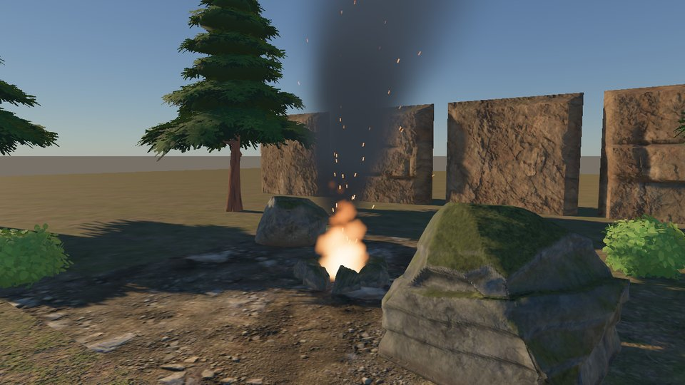
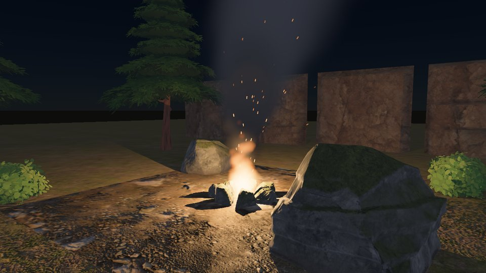
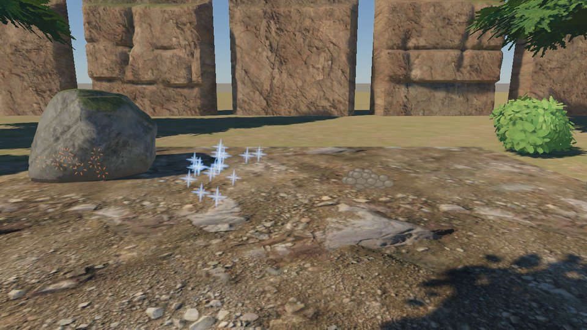
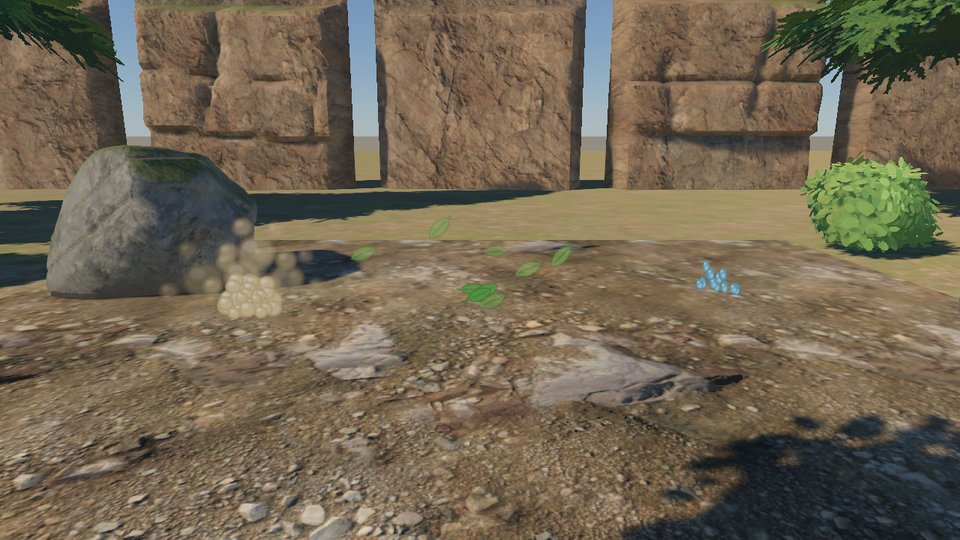
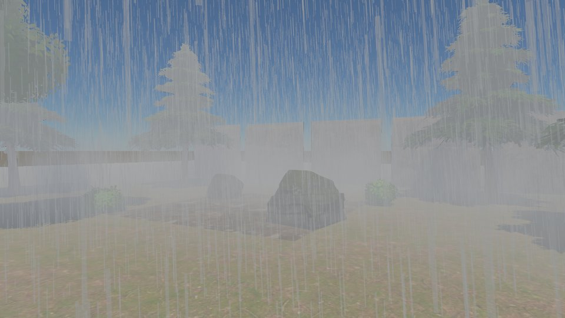
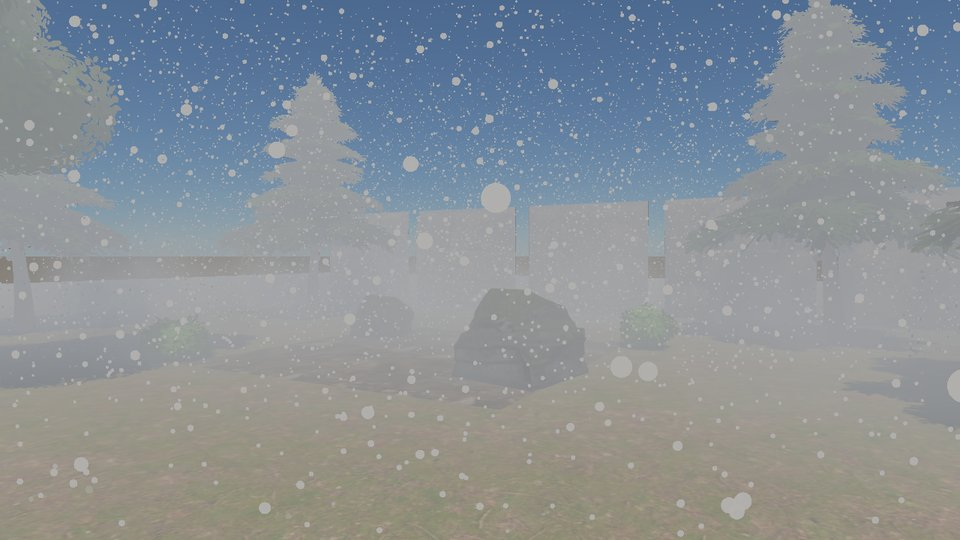

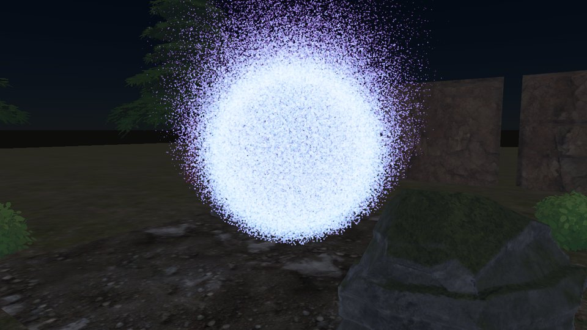

Recordings (1.5 s at 30 fps, every second 1/60 s step):


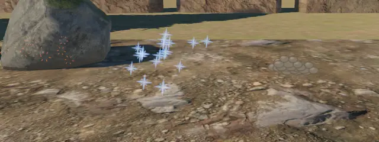
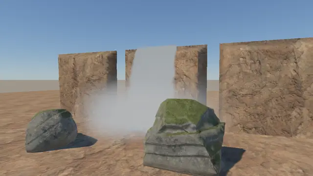

## What works

- Every kit loads and renders: Basis Universal terrain layers, alpha-masked conifer and
  broadleaf foliage, normal-mapped crag faces and rocks, with sun shadows and the sky.
- asset-tooling's 4×4 flipbooks play once over each particle's life, straight-alpha sRGB, with
  linear filtering and clamped addressing: no bleeding between cells, no dark fringes.
- The burst presets map onto the emitter API without engine changes, except the velocity cone
  (below).
- Fire, embers, smoke, rain, snow, mist and a waterfall come out of the existing modifiers
  (sphere and box positions, velocity ranges, constant acceleration, size and colour over life,
  velocity-aligned streaks, round masks).
- CPU cost does not grow with particle count. The simulation is one compute pass and each
  emitter is one indirect draw, so a frame's engine calls cost 0.31 to 0.36 ms (median, RTX
  3060 Ti) from 1k to 1M particles.

## What the first kit scenes showed was missing

These were visible in the first renders of the showcase. Each became a follow-up slice, and the
images above now show 1–3 fixed (soft, lit and fogged particles).

1. **Hard edges against geometry.** The fire's base, the smoke and the mist cut a straight
   line where their quads cross the ground and the rocks, as in bevy_hanabi (D9). Most visible
   in `waterfall` (spray against the rocks) and `rain` (mist on the ground). The fix is soft
   particles (depth fade).
2. **Particles are unlit and ignore exposure.** At night (`campfire_night`) the smoke keeps
   its daylight grey and glows against the sky. The dust in `zoo_bursts` stays bright inside
   the rock's shadow. The particle colour is written as-is, with no lights, shadows or exposure.
3. **No fog on particles.** In `rain` and `snow` the far streaks and flakes stay crisp through
   fog that hides the crag faces behind them.
4. **Many small emitters are expensive on the CPU**: about 25 µs per emitter per frame on
   lavapipe under WSL2, before #85, so 1000 burst emitters cost 25 ms. Each emitter is a draw
   and a 768-byte step upload. On the RTX 3060 Ti with the current engine, it is about 0.8 µs
   (1000 emitters: 1.09 ms, scaling below).
5. **No velocity cone.** asset-tooling's presets emit in a cone (`direction`, `spread`), and
   hanabi's init modifiers have none, so the showcase approximated it with a box of
   velocities. Since #87 the presets use `InitModifier::VelocityCone` (oracle
   `particles_cone`); `combat_bursts` and `zoo_bursts` above are rendered with it. The `trail`
   preset's segment `instances` are not modelled.
6. **Alpha emitters are not sorted inside.** Dense alpha effects (smoke, spray) draw in GPU
   alive-list order, as hanabi does. At the densities here no artefact is visible yet.

The owner decided (2026-11-10) that 1–3 are built as opt-in emitter options, with hanabi
parity kept as the default. Lit and fogged particles get an oracle of Bevy `StandardMaterial`
camera-facing quads; soft particles are checked by tests and these kit scenes. D9 is updated
in those PRs.

## Soft particles (#83)

`Emitter::depth_fade` is opt-in. In the kit scenes the fire (0.35 m), smoke (0.8 m), mist
(1.5 m), waterfall spray (0.6 m) and alpha bursts (0.15 m) use it; `--hard` renders the same
frames without it. Left hard, right soft, same seeds and steps:

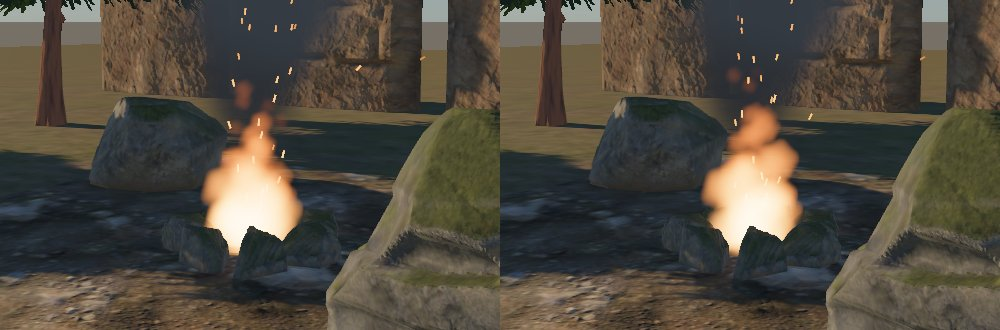
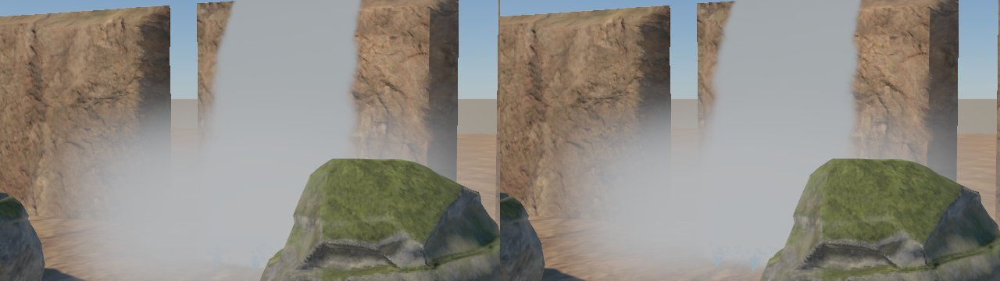

The fire's base no longer cuts a flat line across the stones, and the falling sheet and spray
meet the crag face and the ground without an edge. Since the mist is lit and fogged (#84), the
rain's ground mist shows no visible edge either way: hard and soft differ by at most 10 steps,
in 19 pixels. Its comparison image was dropped. The other oracle particle scenarios still pass
(default path, no fade).

## Lit and fogged particles (#84)

`Emitter::lighting` and `Emitter::fog` are opt-in. In the kit scenes the smoke, mist,
waterfall spray and precipitation are lit (`ParticleLighting::diffuse()`) and fogged; the fire,
embers and magic cloud stay unlit and are fogged; the burst presets keep hanabi's default. The
oracle scenario `particles_lit_fog` gates the shading against Bevy `StandardMaterial` quads
(D9). The images above are rendered with it (2026-11-23, RTX 3060 Ti). At night the smoke
now takes the moonlight and exposure instead of glowing grey against the sky, and the rain and
snow fade into the fog with the crag faces behind them.

## The kits on WebGL 2 (#126)

The browser's WebGL 2 fallback draws particles with `ParticleEmitter`
(`packages/three-lighting/particles.js`), a CPU replay of the engine's simulation. A web game builds
its emitters from the kit's descriptor itself, so `examples/kit_web/` does what such a game would:
it reads `combat-effects` and `zoo-effects` (descriptor, manifest, PNG atlases decoded without
premultiplication and box-filtered into the same mip chain), maps each burst preset as
`kit_showcase`'s `burst()` does, steps the same seeds through the same warm-up and renders through
`Lighting`. `kit_showcase --plain <scene>` renders the same emitters natively over the same plain
background (no terrain, sky or sun, so only the particles differ).

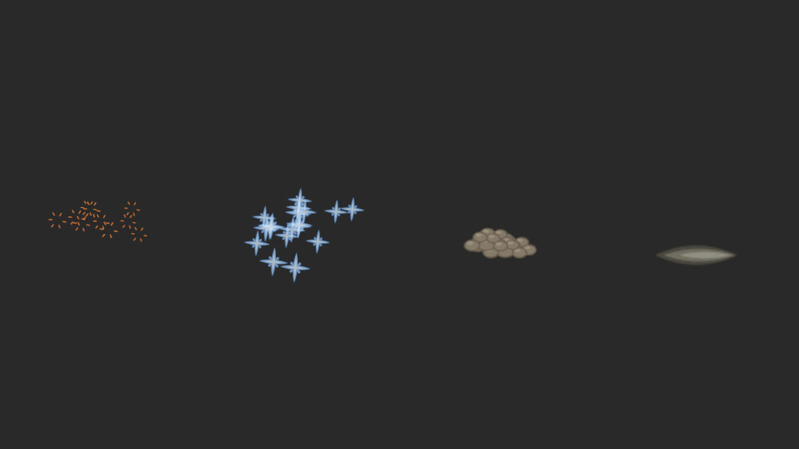
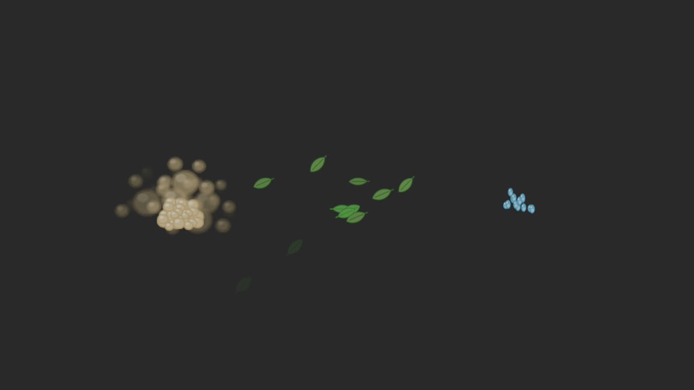

| Scene | Particles alive | Covered pixels, native / web | Pixels differing from native |
| --- | --- | --- | --- |
| `combat_bursts` (spark, block-spark, impact-dust, trail) | 10 / 18 / 6 / 1 | 1.76 % / 1.76 % | 258 of 921,600, each by one 8-bit step |
| `zoo_bursts` (dust, leaf, splash) | 15 / 12 / 14 | 2.83 % / 2.83 % | 129 of 921,600, each by one 8-bit step |

Headless Chromium 159 through ANGLE on lavapipe, against render-engine on lavapipe, 2026-11-22.
Every flipbook frame, fade, size curve and blend mode of the kit presets comes out the same; the
remaining one-step differences are rounding in the two drivers' paths. The plain background leaves
the soft particles' depth fade nothing to fade against, so it is not compared here; the oracle
gates it.

```sh
bash scripts/fetch-kits.sh
cargo run --release --locked --example kit_showcase -- --plain combat_bursts
cargo run --release --locked --example kit_showcase -- --plain zoo_bursts
KIT_VK_ICD=$(ls /usr/share/vulkan/icd.d/lvp_icd*.json | head -1) node examples/kit_web/run.mjs   # lavapipe, as the native side
```

On a hardware GPU, the same page under WSL2 runs on the Intel Arc 140V (integrated) through ANGLE
on Mesa's D3D12 OpenGL driver ([WebGL 2 fallback](webgl2-fallback.md#on-an-integrated-gpu-intel-arc-140v)),
against the same lavapipe native images, 2026-11-23:

```sh
GALLIUM_DRIVER=d3d12 KIT_ANGLE=gl node examples/kit_web/run.mjs
```

| Scene | Particles alive | Covered pixels, native / web | Pixels off by more than 2 steps | Mean max-channel difference |
| --- | --- | --- | --- | --- |
| `combat_bursts` | 10 / 18 / 6 / 1 | 1.76 % / 1.77 % | 0.03 % | 0.011 steps |
| `zoo_bursts` | 15 / 12 / 14 | 2.83 % / 2.83 % | 0.00 % | 0.011 steps |

Every burst spawns the same particles, and the bursts cover the same pixels. The small offset is the
Arc's rounding against lavapipe's, as in the oracle scenarios on the Arc.

On the RTX 3060 Ti both sides ran on the same GPU: `kit_showcase --plain` natively and the page
in headless Chromium 159 through ANGLE on Vulkan, 2026-11-23 (#154):

```sh
cargo run --release --locked --example kit_showcase -- --plain combat_bursts   # and zoo_bursts
node examples/kit_web/run.mjs
```

| Scene | Particles alive | Covered pixels, native / web | Pixels off by more than 2 steps | Mean max-channel difference |
| --- | --- | --- | --- | --- |
| `combat_bursts` | 10 / 18 / 6 / 1 | 1.77 % / 1.77 % | 0.21 % | 0.033 steps |
| `zoo_bursts` | 15 / 12 / 14 | 2.83 % / 2.83 % | 0.03 % | 0.009 steps |

Counts and coverage match. Nearly all the larger differences (up to 51 steps in `combat_bursts`,
98 in `zoo_bursts`) are inside alpha-blended bursts: 1,935 of `combat_bursts`' 1,936 pixels off by more
than 2 steps are on `impact-dust`. There the puffs are the same and cover the same
silhouette, but a different puff lies on top. Inside an alpha-blended emitter, the engine draws in
the GPU's alive-list order, which comes from atomics, as hanabi does (D9). The web side's CPU
replay draws in slot order. Lavapipe happens to keep slot order, so it matched there: native
lavapipe against this NVIDIA web frame differs by at most 6 steps. NVIDIA does not keep it.
This is the draw-order difference D9 already judges statistically, not a difference in the port.

## Measurements

**Adapter:** NVIDIA GeForce RTX 3060 Ti (Vulkan, driver 595.99.02) on the owner's desktop (Linux
7.0, Ryzen 7 5700X), 2026-11-23, with the kits `fetch-kits.sh` pins since #156. 240 frames are
timed per scene. Each run is one process, and the timings are evidence, not a gate. The earlier
figures were measured on lavapipe under WSL2, before #85's per-emitter work. They are in this
file's history.

CPU is one frame's engine calls (`step_particles`, `prepare`, `encode`, submit), without the
wait for the GPU. GPU time is from timestamp queries: the particle simulation and the whole
frame. Particle GPU memory is 140 bytes per slot (particle 64, quad 64, dead slot and two
alive-list entries 12). The step upload is 16 bytes plus 768 per emitter, every step. Draws are
particle / main-pass mesh / shadow.

### Scenes (1280×720, 4× MSAA, after warm-up)

| Scene | Alive | Emitters | Draws | Particle memory | Step upload | CPU ms median / p95 | GPU ms sim / frame median / frame p95 |
| --- | --- | --- | --- | --- | --- | --- | --- |
| `campfire_day` | 221 | 3 | 3 / 17 / 132 | 0.07 MB | 2,320 B | 0.46 / 0.48 | 0.016 / 2.39 / 2.51 |
| `campfire_night` | 226 | 3 | 3 / 17 / 52 | 0.07 MB | 2,320 B | 0.36 / 0.42 | 0.016 / 1.74 / 1.86 |
| `combat_bursts` | 0–35 | 4 | 4 / 14 / 76 | 0.01 MB | 3,088 B | 0.27 / 0.34 | 0.012 / 1.34 / 1.47 |
| `zoo_bursts` | 36 | 3 | 3 / 14 / 76 | 0.01 MB | 2,320 B | 0.28 / 0.34 | 0.012 / 1.36 / 1.49 |
| `rain` | 57,632 | 2 | 2 / 19 / 75 | 8.43 MB | 1,552 B | 0.34 / 0.38 | 0.096 / 2.58 / 2.61 |
| `snow` | 57,751 | 2 | 2 / 19 / 75 | 8.43 MB | 1,552 B | 0.34 / 0.39 | 0.095 / 2.37 / 2.42 |
| `waterfall` | 4,190 | 5 | 5 / 6 / 24 | 0.90 MB | 3,856 B | 0.26 / 0.30 | 0.022 / 1.73 / 1.78 |
| `magic_cloud` | 154,193 | 1 | 1 / 16 / 0 | 28.00 MB | 784 B | 0.17 / 0.22 | 0.229 / 1.30 / 1.30 |

Alive is read after the timed frames. The burst scenes repeat every 0.6 s with shorter
lifetimes, so their count depends on that moment: `combat_bursts` had 35 alive at the screenshot
and none after the timing. The simulation is at most 0.23 ms, even with 154k particles. The rest
of each frame is drawing: scenery, shadows and the particle quads, which were not timed
separately.

### Particle count (one rain emitter in the glade)

| Particles (alive) | CPU ms median / p95 | Particle memory | GPU ms sim / frame |
| --- | --- | --- | --- |
| 1k (958) | 0.31 / 0.34 | 0.14 MB | 0.015 / 1.57 |
| 10k (9.6k) | 0.31 / 0.33 | 1.4 MB | 0.025 / 1.60 |
| 100k (96k) | 0.31 / 0.34 | 14 MB | 0.149 / 2.02 |
| 300k (287k) | 0.35 / 0.40 | 42 MB | 0.417 / 2.92 |
| 1M (958k) | 0.36 / 0.64 | 140 MB | 1.351 / 6.10 |

The CPU side is flat. The simulation grows about linearly from 100k particles (1.35 ms for
958k), and the frame grows with it (6.10 ms at 1M slots). Memory is linear at 140 B per
slot: a 1M-slot pool is 140 MB, which matters on 8 GB cards and in the browser.

### Emitter count (the combat `spark` burst at n places)

| Emitters | CPU ms median / p95 | Step upload | GPU ms sim / frame |
| --- | --- | --- | --- |
| 1 | 0.31 / 0.45 | 784 B | 0.009 / 1.55 |
| 10 | 0.33 / 0.46 | 7.7 KB | 0.014 / 1.56 |
| 100 | 0.39 / 0.57 | 77 KB | 0.044 / 1.59 |
| 500 | 0.76 / 1.04 | 384 KB | 0.191 / 1.75 |
| 1000 | 1.09 / 1.26 | 768 KB | 0.382 / 1.95 |

Per emitter: about 0.8 µs of CPU, 0.38 µs of GPU simulation and 768 B of upload per frame,
whether or not the emitter has live particles. On lavapipe before #85 it was about 24 µs of
CPU. Many small emitters are still where cost grows first. A crowd fight's hit effects are
many small emitters, but 1000 of them now fit in about 1 ms of CPU.

## Not verified

- GPU time on other hardware: the numbers above are one RTX 3060 Ti. Integrated and mobile
  GPUs were not measured.
- The full kit scenes in the browser: only the combat and zoo bursts ran on WebGL 2, over a plain
  background ([above](#the-kits-on-webgl-2-126)); the terrain, props, rain, snow, fire and
  waterfall scenes were not rendered there, nor any kit scene through the WebGPU build.
- Characters: no rigged kit is loaded yet. The Greyhaven bundles have none, and the mmorpg's
  humanoids come from their own releases.
